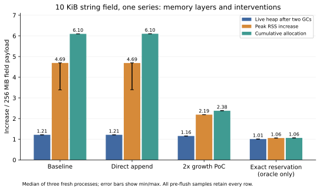
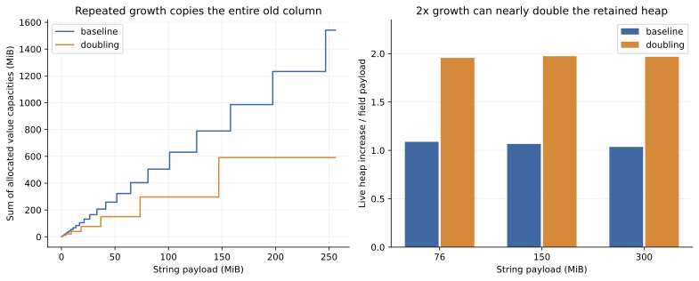

> 本文为 2026-09-21 的实验归档。二进制、heap profile、完整运行数据保留在原实验目录，未纳入 Git；仓库内提供源码、脚本、关键检查点和汇总证据。复现方法见 [README.md](README.md)。本地 Go 源码链接仅在原实验机器上可用。

# 10 KiB 字符串 field 的 memtable 内存膨胀调查

日期：2026-09-21。代码基线：`7fded2ceaf17f70a0cfbd0f8753837c26b5858c5`。本报告针对单机 `ts-server` 的 TSSTORE 写入路径，不外推到 COLUMNSTORE、shelf mode 或集群复制。

## 结论

复现成功。单 series 累计写入约 256 MiB 的 10 KiB 字符串时，基线三次实验的**进程 RSS 峰值增量为 payload 的 4.69 倍（中位数），两次 GC 后的存活堆增量只有 1.21 倍**。不能把前者理解为 memtable 持有了四五份长期存活的数据。

主要原因是同一 series 的字符串列不断追加到一个连续 `[]byte`：大 slice 约按 1.25 倍扩容，每次分配新数组并复制历史内容。旧数组等待 GC，已回收的空闲页又不一定立即归还操作系统。256 MiB 写入累计触发约 1.5 GiB 的列缓冲分配；两次 GC 后实际存活的大字符串列容量约 308 MiB。

对照结果：

- 仅把 `reserveVal + copy` 改为 `append`，基本无改善，扩容几何仍相同。
- 大列翻倍扩容 PoC 将 256 MiB 场景的 RSS 峰值增量降至 2.19 倍、累计分配降至 2.38 倍，但在 76/150/300 MiB 等边界附近，存活堆会接近 payload 的 2 倍。**不建议未经容量预算就直接合入翻倍策略。**
- `GOMEMLIMIT=512MiB` 的本机对照将 RSS 峰值增量降至 2.38 倍，存活堆不变；这是运行时控制手段，不是消除复制，也不是 RSS 硬上限。512 MiB 只是本次试验参数。
- 长期方向应是限制单个连续列缓冲的规模、分块/封存 record、减少历史数据重复制，并把实际持有的 capacity 纳入内存预算。分块的布局微基准已验证潜力，尚未实现完整的 TSSTORE 查询/落盘集成。

所有实验代码、配置、原始数据和补丁均在本目录。原工作区 `/home/duzhiwang/workspace/openGemini` 未修改，实验使用独立 detached worktree `source/`。

## 实验方法与计量口径

环境：Linux 6.8.0-137-generic，Intel i5-10600KF，12 个逻辑 CPU，约 32 GiB 内存，Go 1.26.4，linux/amd64，CGO enabled。完整环境、二进制 SHA256 和依赖记录见 [manifest.json](./manifest.json) 和 `evidence/`。

默认数据模型：一个 database、一个 measurement、一个 shard；一个 `sid` tag、一个字符串 field `payload`；每值 10,240 字节；26,214 行；实际 field payload 为 268,431,360 字节，即 255.996 MiB。时间戳唯一、位于同一个 UTC 小时。默认 HTTP batch=100、客户端并发=1，服务端 read-block-size=64 KiB。开启 WAL，sync interval=100 ms。随机值使用固定种子生成的 128 个模板，逐行带唯一前缀；另有重复内容、引号/反斜杠转义、倒序、并发等对照。

预热先建库并写入一条 `warmup`，两次 GC 后取 baseline。写入阶段不执行查询，也不强制 GC；每个指定 payload 检查点先采集原始状态，再执行两次 GC。之后才进行可选的内存查询、WAL 恢复、强制落盘和读回校验。多阶梯实验在阶梯之间有 GC，不能把其峰值和一次性写入的三次重复组直接混为同一统计组。

本文的倍率均以实际 field 字节为分母，不包含 line protocol tag、field 名、时间戳和转义额外字节：

| 指标 | 计算方式 | 含义 |
| --- | --- | --- |
| 存活堆倍率 | `(HeapAlloc_after_2GC - HeapAlloc_baseline) / payload` | 去掉可回收垃圾后的堆增量，仍含索引、池和元数据 |
| 列 capacity 倍率 | `(Σcap(Val/Offset/Bitmap)_GC - baseline) / payload` | memtable 自有列缓冲容量，不含对象、索引和分配器取整 |
| RSS 峰值增量倍率 | `(VmHWM_loaded - VmRSS_baseline) / payload` | Linux 报告的进程 RSS 高水位增量；不含后续查询/最终 flush |
| 累计分配倍率 | `(TotalAlloc_loaded - TotalAlloc_baseline) / payload` | 写入阶段累计分配量，不是同时存活内存 |

RSS 只采集 ts-server 子进程，不包含 Python 压测客户端。时间线每 100 ms 采样；表格使用检查点的内核 `VmHWM`，避免仅用 100 ms 采样漏掉短峰值。吞吐为客户端观察到的 field MiB/s；P99 为 HTTP batch 延迟，不是单行延迟。小数据量用例的固定开销占比高，仅用于正确性验证，不用于主结论。

## 确保测到 memtable，而不是已经落盘的数据

完整配置见 [baseline1/server.conf](./evidence/checkpoints/baseline1/server.conf)。关键设置：

```toml
[data.memtable]
shard-mutable-size-limit = "1g"
node-mutable-size-limit = "2g"
write-cold-duration = "1h"
force-snapShot-duration = "1h"
max-write-hang-time = "15s"
mem-data-read-enabled = true

[data.compact]
compact-full-write-cold-duration = "24h"

[data.wal]
wal-enabled = true
wal-sync-interval = "100ms"
wal-replay-async = false

[data.shelf-mode]
enabled = false
```

配置和源码审查中的重要细节：

1. `shard-mutable-size-limit` 驱动按 memtable 计账量判断的 snapshot；`node-mutable-size-limit` 是写入资源额度/背压，不是进程 RSS 硬上限。不能只增大其中一个。
2. 本基线 TSSTORE 的时间判断仅检查 `lastWriteTime + writeColdDuration`，见 [ts_storage.go](../../engine/ts_storage.go#L111)。`force-snapShot-duration` 的周期判断在 [cs_storage.go](../../engine/cs_storage.go#L150) 的 COLUMNSTORE 路径。因此只修改 force-snapshot 无法禁止 TSSTORE 的冷写 flush。注意配置键中的 `snapShot` 大小写。
3. 还有管理接口 `POST /debug/ctrl?mod=flush`、shard 关闭、compactor 冷 shard 清理等 ForceFlush 路径；[compact.go](../../engine/compact.go#L98) 在 full-compaction 冷时间满足时也会调用 ForceFlush。没有假设存在一个通用的 `force-flush=false` 配置。
4. 关闭 shelf、hierarchical storage，监控写文件而不是写 `_internal`，一节点一 PT，减少额外 shard 和背景写入。所有监听仅使用本机回环地址，单独占用 18086/18088/18090/18091/18092/18400/18401。
5. 不是仅凭配置相信没有落盘：每个 retained 检查点均验证 flush counter 相对 baseline 没有增长、无 `.tssp`、恰好一个 shard、active 行数等于全部输入加 warmup、snapshot 行数为零。启动阶段 counter 常已是 1，所以检查增量，而非要求绝对值为 0。

独立审计共通过 **130 个 loaded/GC 检查点**，结果见 [artifact_audit.json](./validation/artifact_audit.json)。允许中途 flush 的 `flush32m` 明确排除在 retained 审计之外。

## 根因证据

### 连续字符串列的扩容复制

关键调用链为 `shard.writeRowsToTable → mutable.tsMemTableImpl.appendFields → record.AppendFieldsToRecord → ColVal.AppendString → reserveVal → reserveBytes`。

对应源码：[ts_table.go](../../engine/mutable/ts_table.go#L346)、[column_string.go](../../lib/record/column_string.go#L28)、[utils.go](../../lib/record/utils.go#L190)。`column_string.go` 中保留的 `else` 分支即原写入逻辑；实验分支由 build tag 和环境开关控制。

`reserveBytes` 利用 append 增长底层数组；本地 Go [nextslicecap](/opt/devkits/go126/go/src/runtime/slice.go#L326) 对大 slice 的增长因子趋近 1.25。扩容时必须复制旧数组内容。历史容量形成几何级数：增长因子越接近 1，最终空闲容量越少，但累计分配/复制越多。最终容量为 C 时，理想化的累计分配约为 `C × g/(g-1)`；g=1.25 约为 5C，而不是仅分配一次 C。

精确容量跟踪（含 6 字节 warmup，26,214 条 10 KiB 值）：

| 写入策略 | 最终字符串 Val capacity | 历次 Val capacity 累计 |
| --- | ---: | ---: |
| 原始 reserveBytes | 323,444,736 B（308.46 MiB） | 1,616,374,408 B（1541.49 MiB） |
| 直接 append | 与原始相同 | 与原始近乎相同，仅极小容量处相差 2 B |
| 超过 1 MiB 后翻倍 | 308,281,344 B（294 MiB） | 619,817,608 B（591.10 MiB） |

日志见 `validation/{baseline,append,doubling}_geometry.log`。这也解释了为什么仅省掉填零/拷贝写法，并不能消除历史数组重分配。

使用 baseline 差分的 pprof：

- [alloc_space](./evidence/baseline1_alloc_space.txt)：`record.reserveBytes` 约 1541.81 MiB，占新增累计分配的 **98.46%**。
- [inuse_space](./evidence/baseline1_inuse_space.txt)：同一分配点约 308.46 MiB，占新增存活空间的 **99.15%**。

pprof 为采样估计，不应要求其总量与精确容量完全一致。此处使用两次 GC 后的 profile；没有 GC 的 heap profile 中 alloc 统计可能滞后，不据此低估累计分配。跨阶段累计量以 `runtime.MemStats.TotalAlloc` 为主。

### GC 后 heap 降低，不等于 RSS 立即降低

`scavenge256` 在不落盘、不更改 active 数据的情况下追加了一次 `debug.FreeOSMemory()`。下表为进程绝对值，单位 MiB：

| 阶段 | RSS | HeapAlloc | HeapIdle | HeapReleased |
| --- | ---: | ---: | ---: | ---: |
| baseline | 78.97 | 12.79 | 9.61 | 7.97 |
| 写完 256 MiB | 1279.45 | 572.33 | 669.21 | 31.08 |
| 两次 GC 后 | 1242.23 | 323.47 | 918.38 | 58.40 |
| FreeOSMemory 后 | 392.79 | 323.49 | 918.41 | 917.84 |

HeapAlloc 基本不变，RSS 却从约 1.21 GiB 降到 393 MiB；active 的行数和 capacity 全程不变。这是“已回收但尚未归还 OS 的空闲页”贡献大量 RSS 的直接证据。`HeapReleased` 是 `HeapIdle` 中已归还的部分，两者不能相加。

强制 GC/FreeOSMemory 是诊断干预，不能当作每次写入都执行的生产修复。正常后台 GC/scavenger 时序会带来 RSS 波动。最终 flush 也会发生排序、编码等额外分配，不能用 flush 后的进程历史峰值倒推纯写入峰值。比如 baseline1 的 flush+GC 后堆回到约 16.71 MiB，RSS 仍暂时约 1425 MiB，也不等同于 active memtable 泄漏。

### 当前 mutable 计账并非实际分配容量

[calculateMemSize](../../engine/shard.go#L872) 累加 field key 长度、字符串长度/数值宽度及 tag 的估算成本，再申请 node 额度。它不是 `cap(ColVal.Val)`，也不覆盖 GC 中的旧数组、runtime 空闲页、查询排序和完整的索引元数据。该估算还包含重复 field 名等逻辑项，不能简单说它只是“真实长度”或总是少算某一固定比例。

baseline1 的 active 计账为 268,824,591 B，而单个字符串列 capacity 已为 323,444,736 B；写入峰值还有历史数组和闲置页。故 `node-mutable-size-limit=2g` 或 `shard-mutable-size-limit=1g` 均不能推出 RSS 会被压在同一个数值内。

## 优化对照

以下默认都是一次性写入同样的 255.996 MiB；每组 3 次，表中取中位数。control 为带实验开关但全部关闭的同一二进制，避免只比较不同构建。原始诊断版和 control 结果一致。

| 方案 | GC 后堆增量 / payload | RSS 峰值增量 / payload | 累计分配 / payload | field MiB/s | HTTP P99 ms |
| --- | ---: | ---: | ---: | ---: | ---: |
| 原始诊断版 | 1.213 | 4.689 | 6.102 | 189.7 | 70.6 |
| control：实验开关全关 | 1.213 | 4.690 | 6.097 | 194.8 | 80.0 |
| 直接 append | 1.214 | 4.687 | 6.103 | 193.0 | 71.4 |
| 大列翻倍扩容 | 1.157 | 2.189 | 2.378 | 256.4 | 24.8 |
| 预知最终大小，一次预留 | 1.009 | 1.058 | 1.063 | 288.2 | 21.5 |
| 原算法，GOGC=50 | 1.214 | 3.371 | 6.117 | 193.2 | 59.3 |
| 原算法，GOMEMLIMIT=512MiB | 1.214 | 2.378 | 6.110 | 189.4 | 78.3 |

全部数值见 [results.csv](./results.csv)，分组的 min/median/max 见 [rollup.json](./evidence/rollup.json)。原始诊断版 RSS 倍率范围 3.76–4.72，control 3.39–4.70；翻倍组 2.188–2.190，软限制组 2.377–2.379。样本数小，不将吞吐/P99 作为稳定生产承诺。



翻倍 PoC 相对 control 的中位数：RSS 峰值增量减少约 53%，累计分配减少约 61%，吞吐提高约 32%。但这一容量位置恰好有利，存在下面的反例。

### 翻倍扩容的容量边界退化

| 累计 payload | 原算法 GC 后堆倍率 | 翻倍算法 GC 后堆倍率 |
| --- | ---: | ---: |
| 约 76 MiB | 1.089 | 1.957 |
| 150 MiB | 1.066 | 1.973 |
| 300 MiB | 1.036 | 1.967 |

容量刚跨过翻倍点时，大量预留未使用，但仍是真正存活的数组。调低 GOGC 也不能回收这些被引用的空容量。翻倍策略以更多容量余量换取更少历史复制；不能只看 256 MiB 一个测试点就判定最优。



`prealloc` 使用压测程序事先告知的最终 payload 大小，是用于检验因果链的理想下界实验。在线系统不知道每个 series 最终会写多少，不能给所有 series 都预留整个 shard 的额度。

### 排除项与适用范围

下列除特别说明外为单次辅助实验，主要用于辨别根因，不作精细性能排序：

| 对照 | 结果 | 判断 |
| --- | --- | --- |
| 关闭 WAL | live 1.21 倍，累计分配 6.10 倍，RSS 峰值增量 3.89 倍 | WAL 不是主要分配源；不建议牺牲持久性解决此问题 |
| 禁用所检查的写入大缓冲复用 | live 1.21 倍，累计分配 11.81 倍 | 清池未改善主体，反而增加分配 |
| 上述池只保留 ≤64 KiB buffer | live 1.21 倍，累计分配 10.53 倍 | 不应全局盲目截断池容量 |
| 本地路径只 MarshalRows 一次 | live 1.21 倍，累计分配 6.11 倍 | 冗余序列化可单独优化，但共享 ctx.Buf，不是长期两份 payload |
| 同总量，128 series | live 1.06 倍，RSS 峰值增量 2.13 倍 | 分散后每个连续列更小 |
| 同总量，8192 series | live 1.28 倍，RSS 峰值增量 1.63 倍 | 列变小，但 series/索引/小对象成本上升 |
| 同总量，1 KiB / 32 KiB field | live 1.13 / 1.21 倍；RSS 4.81 / 4.65 倍 | 不是只在 10 KiB 出现的单值 bug，更取决于列累计字节数 |
| 同 26,214 行，1 KiB / 32 KiB | payload 25.60 / 819.19 MiB；live 1.23 / 1.14 倍 | 改变单值大小也改变跨越的容量边界 |
| 完全重复的字符串 | live 仍 1.21 倍 | memtable 原始字符串列不会因内容重复而压缩 |
| CPU=1 / batch=1 | actual unordered=0；RSS 仍 4.22 / 4.05 倍 | 写入峰值不能归因于乱序排序 |

`Row.Clone` 的字符串字段是引用赋值，不是每层都深拷贝 10 KiB；见 [parser.go](../../lib/util/lifted/vm/protoparser/influx/parser.go#L270)。字符串最终进入自有列缓冲时才发生存储拷贝。

客户端按时间升序写，并不保证服务端 record 的 `timeAsd=true`：HTTP 解析 worker 可并发处理读块。默认单客户端实验实际记录 `UnorderedRecords=1`，故报告使用采集到的标志，而非把默认数据称为服务端有序写入。

64 MiB 的 `query_control` 单独测了查询：查询前两次 GC 后 heap 为 79.30 MiB；查询结束未 GC 时 heap 281.96 MiB，RSS 439.67 MiB；再 GC 后 heap 89.88 MiB。active Val 总容量由 64.73 MiB 变为 75.24 MiB，且 record 由乱序变有序。查询排序/读取确实会产生额外复制，预算必须覆盖它，但它不是本文“查询前写入膨胀”的原因。`trimsort` 实验受实际排序排列和 GC 时序影响，未形成可量化的独立净收益证据，不宣称解决了持久泄漏。

## 建议的落地顺序

### 1. 先控制运行峰值，不改变数据语义

在生产代表性负载上配合进程/cgroup 总预算设置 Go 内存软限制，同时为 active、snapshot、查询/编码、索引和非 Go 内存留足余量。Go [SetMemoryLimit 说明](/opt/devkits/go126/go/src/runtime/debug/garbage.go#L181) 的控制量近似 `Sys - HeapReleased`，不是 RSS。限制低于真实存活集合会导致频繁 GC；本次 512 MiB 对照的 RSS 峰值本身仍可超过 512 MiB，不能机械复用这个值。

适当降低 shard mutable 阈值，让大列更早 snapshot；node 额度也要结合同时活跃 shard、snapshot 和写入速率重新估算。`flush32m` 保持 WAL 开启，把 shard 阈值降到 32 MiB 后，写完约 256 MiB 时已完成 5 次额外 snapshot，RSS 高水位约 564 MiB，最终读回 26,215 行正确。但检查点还有一个约 41 MiB 的 snapshot 和约 2 MiB 的 active，不是仍持有完整 256 MiB，所以不能把它的表格倍率当作同等留存量下的结构优化。

snapshot 检查循环约 100 ms，已有 snapshot、在途写入及 flush 吞吐都会造成阈值超调；32 MiB 不是瞬时硬限。较早落盘还增加文件数量、WAL/编码/compaction 开销。本次只验证了可降低工作集，未做长时 compaction 和存储写放大评估。

`GOGC=50` 也降低部分 RSS，但累计分配量不变，GC 次数约从 10 次增为 19–20 次。不要只看 STW pause 判断 GC 的总 CPU 成本；本调查未做长时 CPU 饱和对照。

### 2. 让 memtable 预算看到实际容量

建议保留逻辑 payload 指标，并新增 allocated-capacity 指标，至少分开 active、snapshot、排序/查询临时空间和池留存；不要直接把逻辑数据量重命名为“内存”。按 Val、Offset、Bitmap 容量增量及元数据估算计账，在 ownership 转移时避免重复统计。

如果进一步用 capacity 控制准入，需要设计“扩容前预留、失败回滚、旧 owner 释放”的生命周期。不能持有 chunk/snapshot 锁时阻塞等待必须依赖 flush 才能释放的额度，否则可能死锁。旧 slice 即使已无业务引用，也可能仍计入进程 RSS，所以 capacity 预算还需要运行时和进程预算兜底；单纯改计账不消除复制。

### 3. 减少连续大列的历史重复制

首选验证方向是按字节大小封存 record 或采用有限大小的列块，让已封存数据不因后续 append 再移动。小 series 应惰性分配；不能每个 SID 起步就预留 4 MiB。对于超大单值、跨块 null/offset、时间乱序、重复点覆盖、schema 演进，需要定义清晰的边界。

查询、排序、去重、flush 必须可以跨块流式处理/归并；如果 flush 前再拼回一个超大连续 record，会把问题移到 flush 峰值。WAL 重放、错误回滚、读者引用生命周期、active/snapshot 交接也需要一起覆盖。预计这是侵入性较高但直接针对根因的路线，本次没有冒充已完成此生产改造。

低侵入备选是按同 series/field 的已知批大小预留，并在容量预算允许时选择增长因子。其效果受到实际进入 memtable 的批大小限制：HTTP read block 默认只有 64 KiB，大约只含 6 条 10 KiB 值，HTTP batch=100 不等于 memtable 每次收到 100 条。以下微基准表明小批预留收益有限。

### 布局微基准：方向验证，不是端到端收益

同样写入 3276 条 10 KiB 值（约 31.992 MiB），正常编译器内联，3 次重复的中位时间：

| 布局 | 时间 ms/op | 累计分配 MiB/op | 最终 Val capacity / payload |
| --- | ---: | ---: | ---: |
| 原始增长 | 39.88 | 191.76 | 1.203 |
| 每 6 行批量预留 | 34.72 | 186.69 | 1.173 |
| 每 100 行批量预留 | 33.35 | 162.47 | 1.094 |
| 预知最终大小一次预留 | 5.24 | 32.04 | 1.000 |
| 4 MiB 块布局 | 6.46 | 36.03 | 1.125 |

见 [baseline_benchmark.log](./validation/baseline_benchmark.log) 和 [memory_experiment_test.go](../../lib/record/memory_experiment_test.go#L65)。块布局仅为一组 ColVal 的写入微基准，不含时间列、分组开销、查询、排序或 flush；不可直接据此承诺 TSSTORE 能达到表中的倍数加速。

## 已完成的实现与验证

交付内容：

- `memdiag` build tag 下的私有诊断接口：runtime MemStats、active/snapshot 实际列长与 capacity、行数、series、乱序标志、flush 计数，以及显式 GC/归还页接口。只有显式配置回环地址才启动；普通构建不包含这些接口。
- 独立实验开关：append、doubling、prealloc、singlemarshal、nopools、pool64k、trimsort。普通构建通过常量关闭全部试验行为。
- 可重复运行的单机压测、参数矩阵、统计、pprof、容量跟踪、测试和独立审计脚本；每轮单独数据目录，拒绝覆盖旧结果，检查端口冲突，只终止自己启动的进程，RSS 超过 8 GiB 时停止子进程。
- 两份可重放补丁：`patches/instrumentation.patch` 与 `patches/experiments.patch`，并保留原始、仅诊断、实验和最终验证版二进制。实验与最终验证二进制 SHA256 相同。

共 56 轮服务器实验成功，其中包含 smoke/最终脚本验证。12 项检查全部通过，命令和返回码见 [validation/results.json](./validation/results.json)：

- record、mutable、influx parser、coordinator 的 short 测试，以及 doubling/pool64k/singlemarshal 对应包回归。
- WAL 并行/串行重放、仅 mutable 查询的 engine 定向测试。
- 普通 `!memdiag` 构建路径下的 record/mutable 测试。
- baseline/append/doubling 的布局 benchmark 和精确容量跟踪。
- 新增字符串测试覆盖空值、null、转义、超过 1 MiB 的值、拷贝独立性、复用、排序与重复时间戳覆盖语义。

服务端验证默认检查全部行数以及首/中/末值；额外对 escaped/reverse/并发 8、append/pool64k 做逐行逐字节全量读回及 SHA256；baseline/doubling/singlemarshal 还在未 flush 时等待 WAL sync 后 SIGKILL 自有进程，重启并全量验证，再 flush 后验证。恢复验证不是断电/磁盘故障测试，也不代表所有流式/集群路径已覆盖。

第一次 `query` 用例在刚建 series 后立即查询，返回结构没有 `series` 而失败；保留 `runs/query/error.json` 和日志，未纳入成功统计。结合新 series 索引异步可见的路径，按可见时序问题增加了查询前 2 秒等待，之后 `query_retry`、`query_control` 和恢复用例通过；该原因判断不是对首次响应的完整追踪，首次原始响应未单独保存。固定等待对更慢环境未必足够，若再次触发应检查原始查询结果并改为有界就绪探测，而不是忽略失败。

没有运行整个仓库的全量测试或 race suite，也没有进行多日稳定性测试。代码改动为可验证的调查/PoC，未合并到主工作区，更未把分块设计标记为生产可用实现。复现入口和补丁重放方式见 [README.md](./README.md)。
